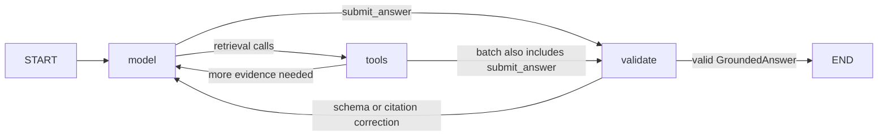

# Document agent

`agent.py` exports `document_agent`, a compiled LangGraph `StateGraph`. OpenAI model calls, retrieval, and grounding checks run through three nodes:



The model receives the product instructions, conversation history, three retrieval tool schemas, and the strict `submit_answer` schema. It must submit a structured `GroundedAnswer` containing answer text, citations, and an `insufficient_evidence` flag. The OpenAI SDK sends requests directly; LangGraph owns routing and state updates.

## State and dependencies

`AgentState` accumulates OpenAI chat messages, pending tool calls, model-request and retrieval-call counts, output retries, and the validated answer. Input contains `messages`; output contains `grounded_answer`.

Each invocation receives a fresh `DocumentAgentDeps` as its LangGraph runtime context:

- `retriever`: searches and reads filing passages.
- `registry`: records full passages retrieved during this turn. Prior-turn citations cannot establish evidence for a new answer.
- `client`: a request-scoped `AsyncOpenAI` client created from `app.config.settings`.

Retrieval arguments are parsed with Pydantic before dispatch. Unknown tools and malformed arguments produce tool feedback without executing retrieval. Calls in the same model response run concurrently after checking the full batch against the retrieval budget.

## Invoke the graph

```python
async with AsyncOpenAI(
    api_key=settings.openai_api_key,
    base_url=settings.base_url,
    max_retries=0,
) as client:
    deps = DocumentAgentDeps(
        retriever=DocumentRetriever(), registry=RetrievalRegistry(), client=client
    )
    result = await document_agent.ainvoke(
        {"messages": [{"role": "user", "content": question}]},
        context=deps,
        config=graph_config(),
    )
    grounded = result["grounded_answer"]
```

Use `graph_config()` for every invocation. It sets a recursion limit that accommodates the configured model-request budget. Follow-up turns prepend user and assistant text from `chat.messages.to_model_history()` to the current user message. Chat persistence stays in Postgres.

## Grounding and limits

The validation node parses `submit_answer` arguments and calls `validate_grounded_answer()`. Every citation must reference a passage in the current registry, copy an excerpt from that passage, and match the answer's inline citation markers. Insufficient-evidence answers must contain no citations. Schema or citation errors are returned to the model as correction feedback.

| Setting | Default | Behavior |
|---------|---------|----------|
| `AGENT_MAX_REQUESTS` | `20` | Maximum document-agent model requests per turn |
| `AGENT_MAX_TOOL_CALLS` | `30` | Maximum retrieval calls; checked before a batch executes |
| `AGENT_OUTPUT_RETRIES` | `2` | Corrections allowed after invalid structured output or citations |
| `AGENT_TEMPERATURE` | `0.2` | Applied to standard chat models |
| `AGENT_REASONING_EFFORT` | `low` | Applied to configured reasoning models |

Request and tool budgets raise `AgentLimitError`; exhausted output corrections raise `GroundingError`. OpenAI SDK retries are disabled so an agent request maps to one model API attempt. Keyword-extraction requests inside retrieval use their own configured model.

## Streaming and tracing

The chat orchestrator consumes `document_agent.astream(..., stream_mode=["custom", "values"])`. Tool and validation nodes emit custom status messages, which become the existing SSE `data-status` parts. The final validated answer is emitted as text deltas and citation parts before assistant persistence. Closing the turn closes the graph stream and OpenAI client.

Logfire spans cover the graph run, model calls, retrieval batches, and validation. `LOGFIRE_INSTRUMENT_OPENAI` controls SDK instrumentation; Logfire configuration comes from the shared settings module.

## Verification

From `backend/`:

```bash
uv run pytest -m "not integration"
uv run python scripts/verify_agent.py "What did Apple's 10-K say about Services revenue?"
```

The fast suite uses the real graph with a mocked OpenAI transport and retrieval boundary. The smoke script and integration tests require model credentials and an ingested corpus.
