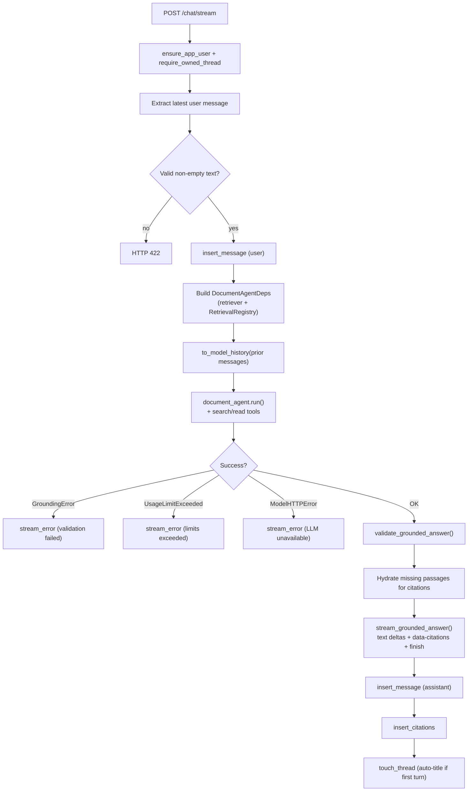

# Chat pipeline

Turn orchestration, AI SDK message conversion, and SSE streaming for grounded Q&A over SEC filings.

The chat layer sits between the HTTP API (`app/api/chat.py`) and the PydanticAI agent (`app/assistant/`). It owns the request lifecycle: validate input, persist messages, run the agent, enforce grounding, stream the response, and write citations back to Postgres.

## Modules

| File | Role |
|------|------|
| `orchestrator.py` | Main turn pipeline — auth, DB writes, agent run, grounding validation, persistence |
| `messages.py` | UI ↔ model message shapes, citation payloads, title truncation |
| `streaming.py` | Vercel AI UI message stream (`text/event-stream`) encoding |
| `__init__.py` | Package marker |

Related code outside this folder: `app/assistant/` (agent + tools), `app/grounding/` (citation contract), `app/retrieval/` (hybrid search), `app/database/chats.py` (threads/messages/citations).

## Default settings

All tunables live in `app/config.py` (env vars in `.env.example`). Values below are the **defaults** when an env var is not set.

### LLM & agent

| Setting | Env var | Default | Used by |
|---------|---------|---------|---------|
| Chat model | `OPENAI_CHAT_MODEL` | `gpt-5-nano` | PydanticAI agent |
| Temperature | `AGENT_TEMPERATURE` | `0.2` | Passed to `document_agent.run()` |
| Reasoning effort | `AGENT_REASONING_EFFORT` | `low` | Agent-level default `model_settings` in `assistant/agent.py` |
| Max LLM requests per turn | `AGENT_MAX_REQUESTS` | `20` | `UsageLimits.request_limit` |
| Max tool calls per turn | `AGENT_MAX_TOOL_CALLS` | `30` | `UsageLimits.tool_calls_limit` |

### Retrieval (agent tools)

| Setting | Env var | Default | Used by |
|---------|---------|---------|---------|
| Candidate pool size | `RETRIEVAL_CANDIDATE_K` | `50` | Hybrid search before RRF trim |
| Results returned to agent | `RETRIEVAL_TOP_K` | `10` | `DocumentRetriever.search()` |
| RRF smoothing constant | `RETRIEVAL_RRF_K` | `60` | Reciprocal rank fusion |
| Neighbor radius | `RETRIEVAL_NEIGHBOR_RADIUS` | `1` | `read_surrounding_chunks` tool (when radius not passed) |
| Min semantic similarity | `RETRIEVAL_SEMANTIC_MIN_SIMILARITY` | `0.0` | Vector leg of hybrid search |

### Chat-local constants

| Constant | Value | Location |
|----------|-------|----------|
| Default thread title | `"New chat"` | `database/chats.py` → `DEFAULT_THREAD_TITLE` |
| Auto-title max length | `50` chars (with `…`) | `messages.truncate_title()` |
| Tool passage text cap | `2000` chars | `assistant/tools.py` → `_TOOL_TEXT_LIMIT` |
| Stream word delay | `0.0` s | `streaming.stream_text_deltas()` (instant emit) |
| SSE protocol | Vercel AI UI v1 | `streaming.STREAM_HEADERS` |

### Thread title behavior

On the **first** user turn (`sequence == 1`) of a thread still titled `"New chat"`, the title is replaced with a truncated copy of the user's message (max 50 characters).

## Pipeline



### Step-by-step

1. **Request** — Client sends `StreamChatRequest` with `threadId` and full `messages` array (Vercel AI SDK shape: `id`, `role`, `parts`).

2. **Authorization** — User is ensured in the app DB; thread must exist and belong to the user (`404` / `403` otherwise).

3. **User message** — The last `role: "user"` message is taken as the current turn. Prior messages (same `id` excluded) become PydanticAI `message_history`.

4. **Persist user turn** — User text and parts are stored with the next monotonic `sequence` for the thread.

5. **Agent run** — A fresh `RetrievalRegistry` tracks every chunk the agent retrieves via tools (`search_filings`, `read_chunk`, `read_surrounding_chunks`). The agent must return structured `GroundedAnswer` (answer text, citations, optional `insufficient_evidence` flag).

6. **Grounding validation** — `validate_grounded_answer()` enforces the citation contract:
   - Non-empty answer
   - If `insufficient_evidence`: no citations allowed
   - Otherwise: at least one citation, unique indexes, excerpts must appear in retrieved passage text, inline `[1]` markers must match citation indexes exactly

7. **Stream response** — On success, the full answer is emitted as word-by-word SSE `text-delta` events, followed by a `data-citations` part and `finish` / `[DONE]`. The client sees the complete answer at once (no live token streaming from the LLM); streaming simulates typing for UX.

8. **Persist assistant turn** — Assistant message (text + citation parts), normalized citation rows, and thread `updated_at` / auto-title are written after streaming completes.

### Error paths

Failed turns **do not** persist an assistant message. The client receives an SSE `error` event with a user-facing message, then `finish` / `[DONE]`.

| Exception | User-facing message |
|-----------|---------------------|
| `GroundingError` | Citation validation failed — retry |
| `UsageLimitExceeded` | Tool/request limit hit — narrow the question |
| `ModelHTTPError` | LLM service unavailable |

## Streaming format

Responses use Server-Sent Events with the Vercel AI UI message stream protocol (`x-vercel-ai-ui-message-stream: v1`):

```
start → data-status (×N) → text-start → text-delta (×N) → text-end → data-citations → finish → [DONE]
```

`data-status` parts carry a `message` string while the agent runs (searching filings, reading passages, drafting, validating). The client should show these before answer text arrives.

Citation payloads include `citationIndex`, `chunkId`, `excerpt`, and filing metadata (`ticker`, `companyName`, `form`, `filingDate`, `page`, `section`, `accessionNumber`).

## API surface

| Method | Path | Handler |
|--------|------|---------|
| `GET` | `/chat/threads` | List threads for current user |
| `POST` | `/chat/threads` | Create thread (default title `"New chat"`) |
| `GET` | `/chat/threads/{thread_id}/messages` | Load persisted messages as UI messages |
| `POST` | `/chat/stream` | Run one grounded turn (SSE) |
