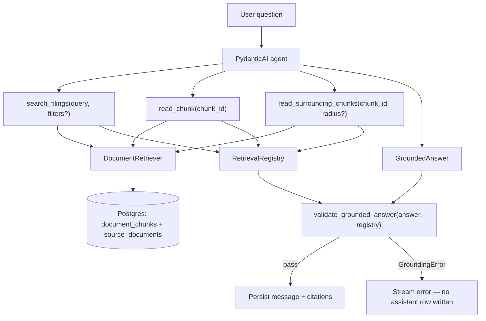

# Retrieval and grounding

Hybrid search over SEC filing chunks, and the citation contract that keeps assistant answers tied to retrieved evidence.

Retrieval finds candidate passages from Postgres (`pgvector` + full-text search). Grounding ensures the LLM only cites chunks it actually retrieved in the current turn, with excerpts copied from passage text. The chat orchestrator runs validation after every agent turn; failed answers are not persisted.

## Modules

| Location | Role |
|----------|------|
| `retrieval/retriever.py` | `DocumentRetriever` — embed query, hybrid search, RRF fusion, fetch passages |
| `retrieval/queries.py` | Runs semantic and full-text searches in parallel |
| `retrieval/keywords.py` | LLM keyword extraction for the full-text search leg |
| `retrieval/fusion.py` | Reciprocal Rank Fusion (RRF) over ranked chunk-id lists |
| `retrieval/types.py` | `SourcePassage`, `SearchFilters`, `ChunkHit` |
| `retrieval/embeddings.py` | Thin wrapper around shared query embedding |
| `database/documents.py` | SQL for vector/full-text search and passage hydration |
| `embeddings.py` | OpenAI embedding client (shared with ingestion) |
| `assistant/tools.py` | Agent tools that call the retriever and register passages |
| `assistant/deps.py` | `RetrievalRegistry` — per-turn map of retrieved chunk IDs → passages |
| `assistant/outputs.py` | `GroundedAnswer`, `Citation` structured output |
| `grounding/validator.py` | Citation contract enforcement |
| `chat/orchestrator.py` | Runs agent, validates grounding, persists citations |

Turn-level orchestration and streaming are documented in [`../chat/README.md`](../chat/README.md).

## End-to-end flow



Each chat turn gets a **fresh** `RetrievalRegistry`. Only passages returned by retrieval tools in that turn are eligible for citation. The validator rejects answers that cite chunks the agent never retrieved, or excerpts that do not appear in the stored passage text.

## Hybrid retrieval pipeline

`DocumentRetriever.search()` is the main entry point. It runs once per `search_filings` tool call.

### Steps

1. **Normalize query** — Strip whitespace; empty query returns `[]`.

2. **Embed query and extract FTS keywords (parallel)** — Two concurrent calls:
   - **Semantic** — `embed_query()` embeds the full query string via OpenAI (`settings.openai_embedding_model`, default `text-embedding-3-small`, 1536 dimensions). Same embedding path as ingestion.
   - **Full-text** — `extract_search_keywords()` calls a small pydantic-ai agent (`settings.retrieval_keyword_model`) to produce 3–5 filing-specific terms. Active `SearchFilters` are passed so the model skips redundant terms (for example, omit "Apple" when `ticker=AAPL`). On failure, the full query is used as a fallback.

3. **Parallel ranked search** — `hybrid_search_chunk_ids()` runs two Postgres queries concurrently:
   - **Semantic** — Cosine distance on `document_chunks.embedding` via pgvector (`<=>`). Results ordered by ascending distance. Optional floor: `retrieval_semantic_min_similarity` (default `0.0`).
   - **Full-text** — `plainto_tsquery('english', keywords)` matched against `document_chunks.search_vector`. Results ordered by `ts_rank_cd` descending.

   Both legs fetch up to `retrieval_candidate_k` chunk IDs (default `50`). Optional filters (`ticker`, `fiscal_year`, `form`) are applied in SQL via `SearchFilters`.

4. **Reciprocal Rank Fusion** — The two ranked ID lists are merged in Python:

   ```
   score(chunk) += 1 / (k + rank)
   ```

   `k` is `retrieval_rrf_k` (default `60`). Chunks appearing in both lists accumulate score from both ranks. Ties break on chunk ID string order.

5. **Trim and hydrate** — Take the top `retrieval_top_k` fused IDs (default `10`). Fetch full `SourcePassage` rows (chunk text + filing metadata) in fused rank order. Attach `rrf_score` on each passage.

### Passage shape

A `SourcePassage` includes everything the agent and UI need to cite a filing:

- Chunk: `chunk_id`, `document_id`, `chunk_index`, `text`, `page`, `section`
- Filing: `ticker`, `company_name`, `form`, `filing_date`, `accession_number`
- Ranking: `rrf_score` (search results only)

### Direct chunk access

Beyond search, the retriever supports:

- **`get_chunk(chunk_id)`** — Fetch one passage by ID (used by `read_chunk`).
- **`get_surrounding_chunks(chunk_id, radius)`** — Fetch the center chunk plus neighbors within `chunk_index ± radius` on the same document (default radius from `retrieval_neighbor_radius`, usually `1`). Used when a table or sentence is split across chunk boundaries.

## Agent tools

Tools live in `assistant/tools.py` but are the primary consumer of retrieval. Each tool registers returned passages in `ctx.deps.registry` so grounding can verify citations later.

| Tool | Behavior |
|------|----------|
| `search_filings` | Hybrid search with optional `ticker`, `fiscal_year`, `form` filters. Returns `{query, result_count, results}` — `results` are ranked passage summaries (text capped at 2000 chars); `result_count` gives the model an explicit, unambiguous stop signal on zero/weak hits. |
| `read_chunk` | Load one chunk by UUID. Returns `null` if missing. |
| `read_surrounding_chunks` | Load neighbor chunks for extra context around a hit. |

Passage summaries sent to the LLM include `chunk_id` so the model can reference them in structured citations. The registry stores the **full** passage text (not the truncated tool payload).

## Grounding

Grounding is a two-layer contract: instructions for the LLM, and deterministic validation in code.

### LLM instructions

`assistant/instructions.md` tells the agent to:

- Retrieve evidence with tools before answering.
- Answer only from retrieved passages — no invented facts.
- Mark factual claims with inline `[1]`, `[2]`, … matching `citation_index` in structured output.
- Copy short `excerpt` strings verbatim from retrieved passage text.
- Set `insufficient_evidence: true` and return empty `citations` when the corpus lacks support.

The agent returns a typed `GroundedAnswer`:

```python
class Citation(BaseModel):
    citation_index: int  # matches [1], [2], … in answer text
    chunk_id: UUID  # must exist in RetrievalRegistry
    excerpt: str  # substring of the passage text


class GroundedAnswer(BaseModel):
    answer: str
    citations: list[Citation]
    insufficient_evidence: bool = False
```

### Validation rules

`validate_grounded_answer(answer, registry)` in `grounding/validator.py` runs **after** the agent completes and **before** streaming or persistence. It raises `GroundingError` on any violation:

| Rule | Insufficient-evidence path | Normal answer path |
|------|---------------------------|-------------------|
| Non-empty answer | ✓ | ✓ |
| Citations | Must be **empty** | Must be **non-empty** |
| Citation indexes | — | Unique |
| Chunk IDs | — | Every `chunk_id` must be in `registry.passages` (retrieved this turn) |
| Excerpts | — | Normalized excerpt must appear in normalized passage text |
| Inline markers | — | Answer must contain `[N]` markers; set of markers must equal set of `citation_index` values exactly |

Whitespace is collapsed when comparing excerpts to passage text, so minor formatting differences do not fail validation.

On `GroundingError`, the orchestrator streams a user-facing error and **does not** write an assistant message or citation rows. The user can retry the turn.

### Post-validation hydration

If validation passes, the orchestrator may fetch any cited chunk not already in the registry (defensive — should not happen when validation succeeds) before building citation payloads for the client and database.

## Configuration

All tunables are in `app/config.py` (see `.env.example`).

### Retrieval

| Setting | Env var | Default |
|---------|---------|---------|
| Candidate pool per search leg | `RETRIEVAL_CANDIDATE_K` | `50` |
| Passages returned to agent | `RETRIEVAL_TOP_K` | `10` |
| RRF smoothing constant | `RETRIEVAL_RRF_K` | `60` |
| Neighbor radius for `read_surrounding_chunks` | `RETRIEVAL_NEIGHBOR_RADIUS` | `1` |
| Min cosine similarity (semantic leg) | `RETRIEVAL_SEMANTIC_MIN_SIMILARITY` | `0.0` |
| Keyword extraction model | `RETRIEVAL_KEYWORD_MODEL` | `gpt-5-nano` |
| Keyword extraction temperature | `RETRIEVAL_KEYWORD_TEMPERATURE` | `0.0` |

### Embeddings

| Setting | Env var | Default |
|---------|---------|---------|
| Model | `OPENAI_EMBEDDING_MODEL` | `text-embedding-3-small` |
| Dimensions | `OPENAI_EMBEDDING_DIMENSIONS` | `1536` |

## Database expectations

Retrieval assumes ingestion has populated:

- `document_chunks.embedding` — pgvector column, HNSW or equivalent index for `<=>` queries
- `document_chunks.search_vector` — generated `tsvector`, GIN index for `@@` queries
- `source_documents` — filing metadata joined on every search and fetch

Filter columns on `source_documents`: `ticker`, `fiscal_year`, `form`.

## Testing

| Test file | What it covers |
|-----------|----------------|
| `tests/retrieval/test_fusion.py` | RRF scoring and ordering |
| `tests/retrieval/test_queries.py` | Hybrid query wiring (mocked DB) |
| `tests/retrieval/test_keywords.py` | LLM keyword extraction and fallback |
| `tests/retrieval/test_retriever.py` | `DocumentRetriever.search()` orchestration |
| `tests/retrieval/test_integration.py` | Live DB + OpenAI (`@pytest.mark.integration`) |
| `tests/grounding/test_validator.py` | Full citation contract |
| `tests/assistant/test_tools.py` | Tool registration in `RetrievalRegistry` |

Fast suite: `uv run pytest -m "not integration"` from `backend/`.

Manual smoke test: `uv run python scripts/verify_retrieval.py`.

## Design notes

- **Hybrid over single-mode** — Semantic search finds paraphrases; full-text catches exact tickers, figures, and legal phrases. RRF combines both without calibrating scores across modalities.
- **Search in Postgres, fuse in Python** — Keeps ranking policy in application code and avoids a single complex SQL fusion query.
- **Registry per turn** — Citations cannot reference chunks from prior turns or hallucinated IDs; the validator only sees what tools returned in the current run.
- **Grounding separate from PydanticAI** — Retrieval and validation are unit-testable without calling the LLM. The prompt instructs good behavior; the validator enforces it.
